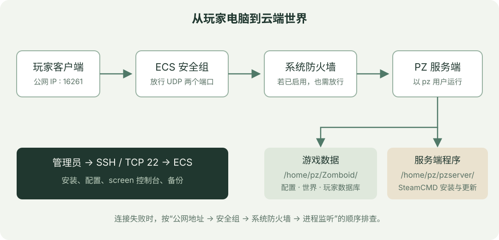
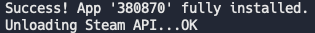

最近想和朋友联机玩 Project Zomboid（僵尸毁灭工程）。本地开主机有些不方便：房主不在线，别人就玩不了；房主的电脑还要同时运行客户端和服务端。于是，我用阿里云 ECS 搭了一个专用服务器，把安装、调参和存档管理的过程记录下来。

这次使用的是 **Ubuntu 22.04、4 核 8 GB 内存的 x86_64 ECS**。下面以默认服务器名称 `servertest` 为例；如果你用了其他名字，启动参数、配置文件名和备份范围也要一起调整。

**先确认游戏版本。** SteamCMD 默认安装服务端的公开分支，客户端必须与它匹配。不同 Build 的联机支持、端口和启动文件可能变化，跨 Build 的 Mod 与存档也不一定兼容。本文记录这次部署方法，不把它当作所有版本都通用的配置；切换分支前先确认该分支支持专用服务器，并单独备份世界。

## 一、服务器怎么选

PZ 服务端使用 Java，部分关键逻辑对单核性能比较敏感。对朋友之间的小规模联机，我会先保证内存和单核性能，再考虑增加核数。

| 项目 | 这次的选择 | 选择时需要考虑什么 |
| --- | --- | --- |
| 实例 | 阿里云 ECS 免费试用 | 也可以比较轻量应用服务器的套餐、流量与续费价格 |
| 规格 | 4 核 8 GB | 少量玩家原版可以从较小规格尝试；地图和 Mod 多时要留更多内存 |
| 架构 | x86_64 / amd64 | 本文安装的是 Linux x86 服务端，不直接适用于 ARM 实例 |
| 系统 | Ubuntu 22.04 | 使用 Linux，方便通过 SSH 维护 |
| 公网带宽 | 按人数和实际表现调整 | 低带宽可能影响首次进服、地图同步和车辆移动，不能只看平时流量 |

原来我考虑过 1～5 Mbps 的带宽，但不建议把“1 Mbps 一定够用”当作结论。人数、地图探索速度和 Mod 都会影响网络需求。如果多人一起跑图时明显卡顿，可以结合 ECS 出网带宽与服务端负载判断瓶颈。



## 二、先放行安全组，再登录服务器

### 配置安全组

ECS 安全组在实例外面过滤网络流量。服务端即使正常启动，端口没放行，朋友仍然连不上。

在 ECS 控制台进入实例的安全组配置，添加**入方向**规则。本次部署使用以下端口：

| 用途 | 协议 | 端口范围 | 访问来源 |
| --- | --- | --- | --- |
| 游戏连接 | 自定义 UDP | `16261/16262` | `0.0.0.0/0`，或朋友的公网 IP 段 |
| SSH 管理 | TCP | `22` | 建议限定为自己的公网 IP，例如 `你的IP/32` |

这里的 `16261/16262` 是阿里云界面里表示连续端口范围的写法，即放行 16261 和 16262。协议要选 **UDP**。不要为了方便直接开放全部端口。

`0.0.0.0/0` 表示所有 IPv4 地址都能尝试访问这两个游戏端口，适合朋友地址不固定时使用；仍然需要设置进服密码。若修改了服务端端口，或所用版本有额外要求，安全组规则也要同步调整。

### SSH 登录

在自己电脑的终端执行：

```bash
ssh root@你的公网IP
```

本文用 `root` 演示系统安装操作。如果实例提供的是普通管理员账号，请使用该账号登录，并在需要管理员权限的命令前加 `sudo`。

如果出现 `Permission denied (publickey)`，先检查实例绑定的密钥和登录用户名。有密钥时可以指定私钥文件：

```bash
ssh -i ~/.ssh/你的私钥 root@你的公网IP
```

如果决定改用密码登录，可在控制台重置实例密码，并按控制台提示重启或等待生效；系统也必须允许对应账号通过密码登录。单纯重置密码不一定能解决禁用了密码认证的问题。

如果系统启用了 UFW，还需要检查系统防火墙：

```bash
sudo ufw status
# 仅在 UFW 已启用、且需要添加规则时执行
sudo ufw allow 16261:16262/udp
```

安全组与 UFW 是两层独立规则。不要为了开游戏服直接启用 UFW；若确实需要启用，先确认 SSH 的放行规则，避免把自己锁在外面。

## 三、安装 SteamCMD 和服务端

以下先以 `root` 执行。游戏进程单独交给 `pz` 用户运行。

```bash
apt update
apt install -y lib32gcc-s1 lib32stdc++6 screen curl ca-certificates nano

useradd -m -s /bin/bash pz
su - pz
```

如果已经创建过 `pz` 用户，跳过 `useradd`。接下来以 `pz` 用户下载 SteamCMD，并安装服务端：

```bash
mkdir -p ~/steamcmd
cd ~/steamcmd
curl -fSL --retry 3 \
  https://steamcdn-a.akamaihd.net/client/installer/steamcmd_linux.tar.gz \
  -o steamcmd_linux.tar.gz
tar -xzf steamcmd_linux.tar.gz

./steamcmd.sh \
  +force_install_dir /home/pz/pzserver \
  +login anonymous \
  +app_update 380870 validate \
  +quit
```

`380870` 是 Project Zomboid Dedicated Server 的 App ID。看到下面的成功提示，才算安装完成：



我遇到过 `Failed to install app '380870' (Missing configuration)`。这类错误可能与 Steam 接口连接、服务状态或分支配置有关，可以先检查网络并重试；不要把所有错误都归为国内网络问题。如果匿名登录一直失败，也可以按 SteamCMD 的交互提示使用自己的 Steam 账号登录，不要把密码写入脚本。

服务端自带所需的 Java 运行环境时，直接使用它即可，不必额外安装一个 Java 版本来替换。

## 四、先调整内存，避免启动就被杀掉

这次部署最明显的坑是内存。启动配置里的 Java 堆上限如果接近整台机器的物理内存，就没有空间留给系统、原生库和其他开销，启动或加载世界时可能触发 OOM。

我安装的版本在下面这个文件里设置 JVM 参数：

```bash
nano /home/pz/pzserver/ProjectZomboid64.json
```

检查 `vmArgs` 中的 `-Xms` 和 `-Xmx`。如果是 `8g`，在 8 GB 的机器上可以先改成：

```json
"-Xms2g",
"-Xmx4g"
```

`Xms` 是初始堆大小，`Xmx` 是最大堆大小，不需要设成相同值。4 GB 只是这台机器的起点；Mod 较多时应结合实际内存占用调整，不能把全部物理内存都分给 Java。其他版本也可能把参数放在不同的启动文件中，以实际安装内容为准。

如果日志最后只有一行 `Killed`，可由管理员检查内核日志：

```bash
sudo journalctl -k --since "30 minutes ago" | grep -Ei 'out of memory|oom|killed process'
free -h
df -h
```

### 可选：添加 Swap 作为缓冲

Swap 可以缓解短时内存压力，但持续换页会让游戏明显变慢。它不能替代足够的物理内存。

先执行 `swapon --show` 检查已有交换空间。以下命令仅用于**尚无 `/swapfile` 且确实需要新建交换文件**的实例，以 `root` 执行一次：

```bash
fallocate -l 4G /swapfile
chmod 600 /swapfile
mkswap /swapfile
swapon /swapfile
echo '/swapfile none swap sw 0 0' >> /etc/fstab
free -h
```

不要重复执行创建与追加操作，也不要覆盖已经在用的交换文件。磁盘空间不足时，应先扩容或清理。

## 五、首次启动，生成配置

回到 `pz` 用户环境：

```bash
su - pz
cd /home/pz/pzserver
bash start-server.sh -servername servertest
```

如果当前已经是 `pz`，直接从 `cd` 开始。首次启动会初始化世界、生成配置，并可能提示设置游戏内 `admin` 账号的密码。**管理员密码与朋友进服用的服务器密码是两件事。**

看到 `SERVER STARTED` 一类提示后，再确认服务器保持运行并能实际连接。启动日志里的贴图重复、地图数据警告不一定致命，但 `ERROR` 也不能一概忽略。例如 `libjsig.so` 的预加载提示，只有在后续确实启动成功且运行正常时，才可以暂时放下；如果进程退出，要继续看完整日志。

在服务端控制台输入：

```text
quit
```

等待进程完成保存并退出，再进行下面的配置替换。正常关服优先使用 `quit`，不要直接强制结束进程。

## 六、在本地游戏里配好设置，再上传

比起从零手改 `.ini`，我更喜欢先在本地游戏界面里把参数调好。

1. 游戏主菜单进入 **建立服务器（Host）→ 管理设置**，创建名为 `servertest` 的设置。
2. 配置服务器名称、进服密码、人数、沙盒规则和 Mod。
3. 保存设置，确认本地客户端与服务端使用匹配的游戏版本。
4. 关停云端游戏服务，再上传对应配置文件。

本地配置目录通常是：

| 系统 | 配置目录 |
| --- | --- |
| Windows | `C:\Users\你的用户名\Zomboid\Server\` |
| macOS / Linux | `~/Zomboid/Server/` |

常见文件包括 `servertest.ini`、`servertest_SandboxVars.lua` 和 `servertest_spawnregions.lua`。如果配置引用了自定义出生点文件，也要一起上传。

下面以 macOS 为例，**在本地终端**执行。这里的 `*` 会匹配本地已生成的配置文件；若 zsh 提示没有匹配项，先检查路径和设置名称：

```bash
scp "$HOME/Zomboid/Server/servertest"* \
  root@你的公网IP:/home/pz/Zomboid/Server/
```

上传后，以 `root` 在云端修正属主：

```bash
chown pz:pz /home/pz/Zomboid/Server/servertest*
```

这一步只替换配置文件，不会直接删除世界；但改变地图、移除 Mod 或修改某些世界参数，仍可能影响既有存档。大改之前先备份。

### Mod 有两个编号，别混在一起

`WorkshopItems` 填的是创意工坊项目 ID，`Mods` 填的是 Mod 自己定义的 ID，两者不一定相同。一个工坊项目也可能包含多个 Mod。地图 Mod 还可能涉及地图目录和加载顺序。

服务端会下载配置需要的工坊内容，客户端加入时通常也会进行下载或校验。如果提示版本不匹配，先确认游戏分支、Mod 依赖以及双方是否更新完成；涉及地图和大型整合包时，最好先用新世界验证。

## 七、用 screen 保持后台运行

前台启动的服务可能随着 SSH 会话关闭而结束。使用 `screen`，可以断开 SSH 后让进程继续运行，也能随时回到控制台。

以 `pz` 用户执行：

```bash
screen -S pz
cd /home/pz/pzserver
bash start-server.sh -servername servertest
```

启动成功后，按 **Ctrl+A，松开，再按 D**，即可脱离会话。不要按 Ctrl+C，那会中断前台进程。

之后重新 SSH 登录，切换到同一个 `pz` 用户，再执行：

```bash
screen -ls       # 查看会话
screen -r pz    # 回到游戏控制台
```

`screen` 只负责保持会话，**不等于开机自启，也不会在服务崩溃后自动重启**。ECS 重新开机后，需要重新启动游戏服。想进一步自动化，可以再配置 systemd；朋友小服先用 screen 已经比较直观。

## 八、进游戏，以及连不上时怎么排查

游戏内进入“加入”，填写服务器**公网 IP**、端口 `16261`、玩家用户名和服务器密码。玩家用户名通常可自行创建，但是否允许新玩家注册，取决于服务器的开放注册、白名单等配置。

如果直接连接失败，可以按下面的顺序检查：

| 现象 | 优先检查 |
| --- | --- |
| 一直超时 | 公网 IP 是否变化、安全组与 UFW 是否放行 UDP |
| 云端看起来启动了，但还是连不上 | 进程是否仍存活、是否监听正确端口、是否真的完成启动 |
| 游戏版本不匹配 | 客户端和服务端的 Build、Steam 测试分支 |
| Mod 校验失败 | 工坊 ID、Mod ID、依赖和双方更新状态 |
| 玩一会儿突然掉线 | OOM 日志、服务端负载、出网带宽与磁盘空间 |

在云端检查 UDP 监听情况：

```bash
sudo ss -lunp | grep -E ':(16261|16262)\b'
```

这只能确认本机监听，不能证明外部玩家已经能连通。普通 TCP 端口检测网站也不能验证 PZ 的 UDP 游戏连接，最后仍应从客户端实际加入测试。

## 九、存档备份：把世界、配置和玩家数据一起保住

只保存 `Saves/Multiplayer/servertest/` 里的地图还不够。重建实例时，还可能需要服务器配置、玩家账号数据库和 Mod 相关数据。

最省心的迁移范围是整个 `/home/pz/Zomboid/` 用户数据目录。里面可能含有进服密码、账号信息和日志，备份应放在自己的电脑或私有存储中。

### 日常备份与离线迁移分开处理

运行中直接用 `tar` 打包世界，可能碰到不同文件在不同时间被写入，压缩包成功生成也不代表它能一致恢复。

日常游玩可以先检查当前版本生成的 `.ini` 是否支持 `BackupsOnStart`、`BackupsOnVersionChange`、`BackupsPeriod` 等内置备份选项，并按文件中的说明配置。例如部分版本的 `BackupsPeriod` 以分钟为单位，`360` 表示六小时；请以当前版本注释为准，别凭名称猜单位。启用后，检查实际生成的备份、保留数量和覆盖范围，再做一次恢复验证。

**释放实例、升级大版本或迁移之前，仍建议正常关服后做一次完整离线备份。** 在 screen 控制台输入 `quit`，等待退出，然后以 `pz` 用户执行：

```bash
mkdir -p /home/pz/backups
chmod 700 /home/pz/backups
umask 077

# 排除历史备份目录，避免把旧压缩包反复打进去
tar --exclude='Zomboid/backups' \
  -czf "/home/pz/backups/pz-data-$(date +%Y%m%d-%H%M%S).tar.gz" \
  -C /home/pz Zomboid
```

如果自定义过缓存目录或备份路径，要相应调整打包范围。备份后可以用 `tar -tzf 备份文件.tar.gz` 检查目录结构；更可靠的验证是在独立目录或测试实例中实际恢复。

接着**在本地电脑**拉回压缩包：

```bash
mkdir -p ~/pz-saves
scp 'root@你的公网IP:/home/pz/backups/pz-data-*.tar.gz' ~/pz-saves/
```

这里的远程通配符需要引号，且 `scp` 复制目录时才需要 `-r`。备份留在同一块云盘上不能应对实例被释放，至少保留一份独立副本。

我没有继续沿用“每六小时直接打包正在运行的存档，再自动删除旧包”的 cron 方案。只有确认备份一致、恢复成功后，自动清理旧版本才有意义。

### 恢复时先保留现状

先关服，并把备份上传到云端。下面以 `root` 操作，**仅解压自己可信的备份**：

```bash
tar -tzf /root/pz-data-你的时间戳.tar.gz | head -30
# 正常应看到 Zomboid/ 开头的目录与文件

# 若已经有数据目录，先改名保留，不直接删除
if [ -d /home/pz/Zomboid ]; then
  mv /home/pz/Zomboid "/home/pz/Zomboid.before-restore-$(date +%Y%m%d-%H%M%S)"
fi

tar -xzf /root/pz-data-你的时间戳.tar.gz -C /home/pz
chown -R pz:pz /home/pz/Zomboid
```

然后用相同的 `-servername servertest` 启动，并检查世界、角色和 Mod 是否正常。备份不会固定 Steam 分支或工坊内容，旧档不保证能直接放进新版本；需要同时记录原来的游戏版本和 Mod 列表。

## 十、按量计费怎么省钱

### 优先考虑停机节省计算费用

如果不是每天都玩，可以比较按量计费实例的停机策略。符合条件的实例通常可以选择节省停机模式，使停机期间的计算资源不再计费；**具体支持条件、名称和费用以当前控制台为准**。

系统盘、数据盘以及部分网络资源仍可能收费，包年包月实例也不是关机就能退回相应费用。不要只看“停机不收费”几个字就认为整台服务器零成本。

我的操作顺序是：游戏控制台 `quit` → 等待保存退出 → 做备份 → 在 ECS 控制台停止实例。下次启动后检查公网 IP 是否变化，再重新启动游戏进程。

### 释放实例之前，先算迁移成本

释放实例后，下次要重新创建机器、配置安全组、安装服务端、恢复备份，还要确认版本兼容。免费试用结束后也不一定能以同样条件再次创建。

如果确实需要反复重建，可以下载这份[基础部署脚本](pz-server-setup.sh)。它只负责安装依赖、创建用户、重试下载服务端和调整 Java 堆参数；三次安装都失败时会明确退出。它不自动覆盖存档、不修改安全组，也不自动设置 Swap。

先阅读脚本，再上传到新实例，以 `root` 运行：

```bash
bash /root/pz-server-setup.sh
```

安装成功后，按前面的流程恢复完整数据目录，再进入 screen 手动首次启动。首次管理员密码等交互处理完之后，再考虑无人值守启动，避免后台进程停在等待输入的状态。

## 开服之后，最需要记住的几件事

这次让我花时间最多的是内存配置和 UDP 端口：服务端程序装上只是第一步，Java 还需要给系统留出余量，安全组也要放行正确的协议。真正开始长期玩之后，版本记录和可恢复的备份比一键重装更有用。

朋友之间的小服，可以先从“SteamCMD 安装 → 调整内存 → 前台确认启动 → 配置上传 → screen 后台运行”这条路线跑通。等大家都能进服、存档也能恢复，再慢慢加 Mod 和自动化。

祝大家和朋友们在肯塔基州活得久一点。

## 参考资料

- [Project Zomboid Wiki：Dedicated server](https://pzwiki.net/wiki/Dedicated_server)
- [Valve Developer Community：SteamCMD](https://developer.valvesoftware.com/wiki/SteamCMD)
- [阿里云 ECS 官方文档](https://help.aliyun.com/zh/ecs/)
